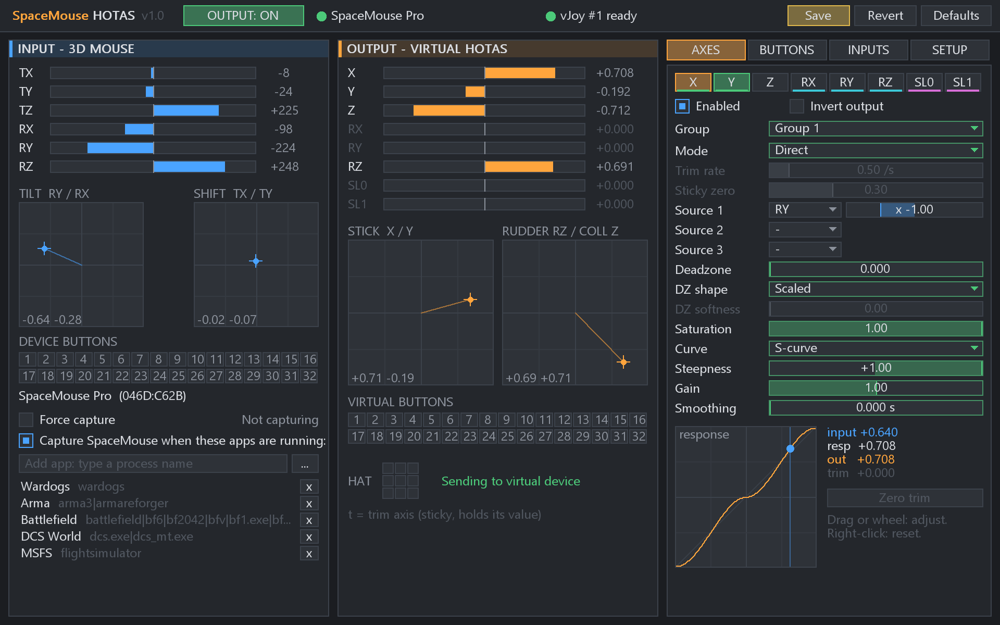

# SpacemouseHOTAS

### A tiny app to turn any 3Dconnexion SpaceMouse into a regular virtual HOTAS joystick for gaming



https://github.com/user-attachments/assets/65f559a3-7738-4621-900c-78fa19096259

(higher quality video [here](https://youtu.be/gp9K1vORL8Y))

## WARNING: AI SLOP AHEAD
### 70% of this project is unadulterated LLM-generated garbage. Treat it as such.
This is a single evening experiment, and I'm only releasing it because I have friends who want to play with this but aren't programmers or engineers.

If you like well-written, maintainable code, perhaps look elsewhere. I rigidly defined the requirements/spec and cleaned up some of the code, but it's still not very good.

The software works, and does what it says on the tin, at least on Windows. Don't expect anything more than that.

## Setup

1. Make sure you have 3DConnexion's 3DXWare drivers and software installed.
2. Install the signed vJoy 2.2.x. driver from [here](https://github.com/BrunnerInnovation/vJoy/releases/tag/v2.2.2.0) (the executable installer).
3. Download the latest build from the Releases page and run it. There is no installation, wherever you put it is where it will live.
4. Go to the Setup tab, click **Configure vJoy** to send the SpaceMouse config to the driver.
This allows you to use all 8 axes, 32 buttons, and emulate one HAT. Generally, you only need to do this once.
5. Close other vJoy feeders, save the config.
6. In the **Input** section, add your game to the list of processes that will trigger the software to convert SpaceMouse input into HOTAS. This grabs the SpaceMouse through 3DxWare app and prevents it from sending raw SpaceMouse input to games.

## Config file

Configurations are persistent.

`%APPDATA%\SpacemouseHOTAS\config.ini`\
`~/.config/spacemousehotas/config.ini`\
`~/Library/Application Support/SpacemouseHOTAS/config.ini`.

## Build

```
cmake -S . -B build
cmake --build build --config Release
```

| OS | Tested | Input | Output | Needs |
|---|---|---|---|---|
Windows | Yes | Raw Input | vJoy driver (own feeder, no vJoy DLLs) | [vJoy 2.2.x](https://github.com/BrunnerInnovation/vJoy/releases/tag/v2.2.2.0) driver |
Linux | No | hidraw | uinput | libX11, libXft; udev rule in `packaging/linux` |
MacOS | No | IOHIDManager | IOHIDUserDevice | virtual-HID entitlement or root |

## License

SpacemouseHOTAS is licensed under MIT, see [LICENSE](LICENSE).

The vJoy feeder is based on the [vJoy](https://github.com/BrunnerInnovation/vJoy) driver interface by Shaul Eizikovich (MIT); see [THIRD_PARTY_NOTICES.md](THIRD_PARTY_NOTICES.md).
